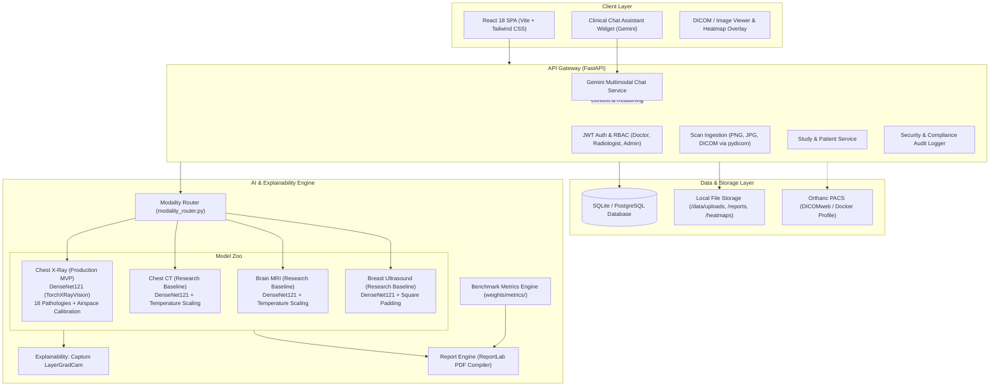
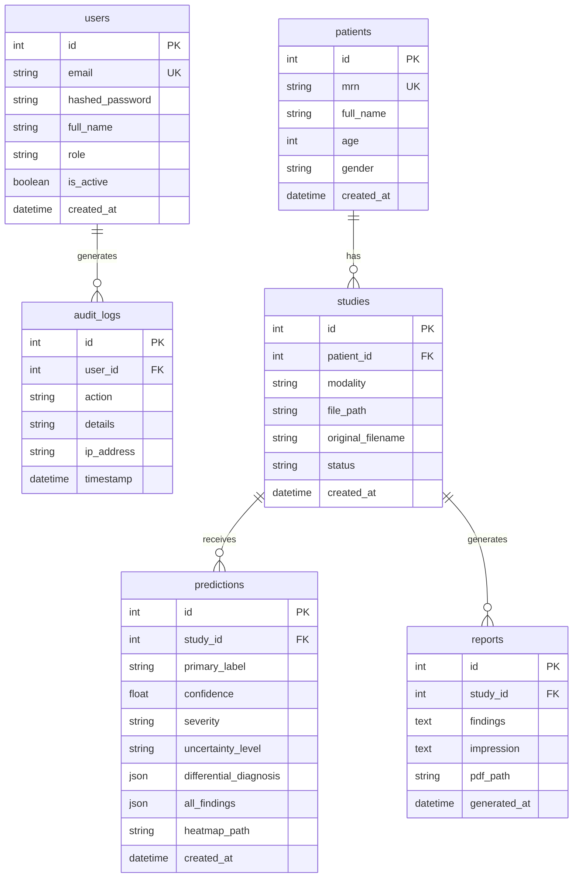
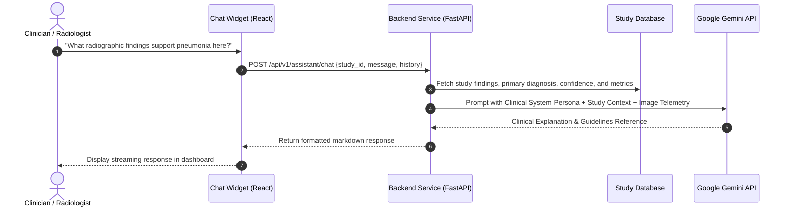

# Radiology AI Assistant — System Architecture

This document describes the high-level system architecture, service interactions, AI pipeline workflows, data models, and clinical governance mechanisms of the Radiology AI platform.

---

## 1. High-Level Architecture Diagram

---

## 2. Multi-Modal Pipeline Execution Flow

When a clinician requests analysis (`POST /api/v1/predict/{study_id}`):

1. **Scan Retrieval & Validation**:
   - The file is retrieved from disk. DICOM files are parsed with `pydicom`, normalized, windowed, and converted to high-fidelity visual representations.
2. **Modality Routing**:
   - Based on user selection, study metadata, or DICOM modality headers, the request is dispatched via `AI/modality_router.py`.
3. **Model Inference**:
   - **X-Ray (XR)**: Run through TorchXRayVision DenseNet121. Calibrated operating thresholds evaluate 18 thoracic pathologies. Specific airspace consolidation logic evaluates Pneumonia with severity scoring (*Mild* / *Moderate* / *Severe*), confidence estimation, and prediction margin.
   - **CT / MRI / Ultrasound (Research Baselines)**: Evaluated through modality-specific DenseNet121 classifiers. The baseline feature flag (`ENABLE_BASELINE_MODELS=1`) is checked; if disabled or weights are missing, the pipeline safely **fails closed** with an HTTP 503 response. Softmax probabilities are adjusted using dataset-fitted temperature parameters.
4. **Visual Explainability (Grad-CAM)**:
   - For all modalities, Captum `LayerGradCam` extracts feature maps from the final dense block. A false-color Jet colormap is blended with the original grayscale image to produce an explainable heatmap overlay.
5. **Clinical Report Generation**:
   - `AI/report_generator.py` compiles dynamic findings and impression statements. For research baselines, hold-out benchmark metrics (accuracy, 95% bootstrap confidence intervals, and macro AUC) are injected directly into the findings text alongside clinical disclaimers.
   - ReportLab compiles a publication-grade PDF stored in `data/reports/report_{study_id}.pdf`.
6. **Persistence & Response**:
   - Predictions, confidence metrics, differential diagnoses, and file paths are saved in the database and returned to the frontend.

---

## 3. Database Schema

---

## 4. Multimodal Clinical Chat Assistant Architecture

The clinical chat assistant (`POST /api/v1/assistant/chat`) provides on-demand radiologic reasoning:

---

## 5. Security & Governance

- **Fail-Closed Baseline Gate**: Non-validated research baseline models cannot run unless explicitly enabled in environment variables (`ENABLE_BASELINE_MODELS=1`) and verified on disk.
- **Audit Logging**: Every patient creation, image upload, analysis execution, and report download is timestamped and recorded in `audit_logs`.
- **Role-Based Access Control (RBAC)**: Role checks verify user permissions across `doctor`, `radiologist`, and `admin` scopes.
- **Data Protection**: Medical scans and generated reports are stored on controlled filesystem paths with restricted direct access.
